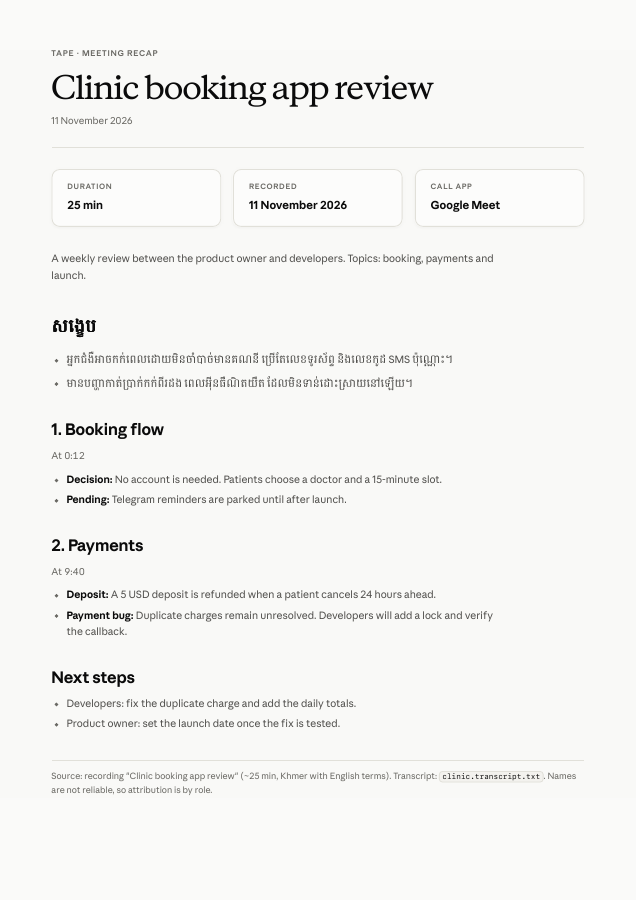
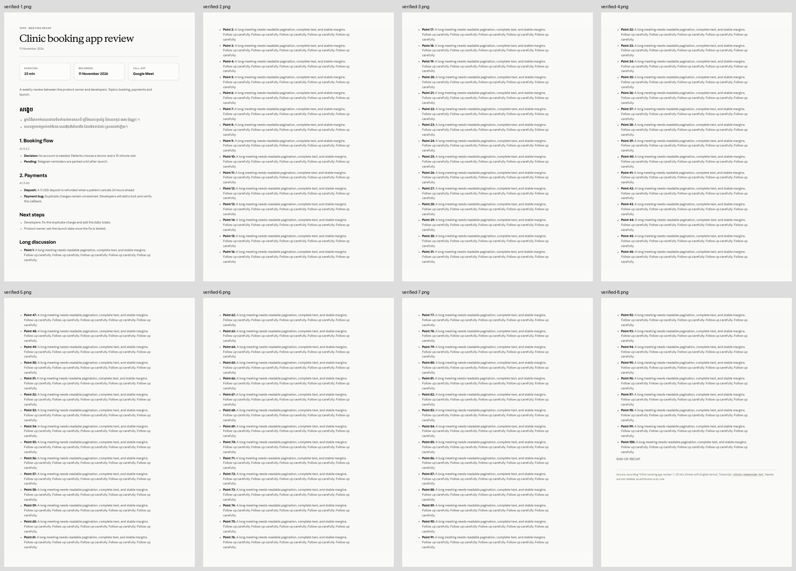

# Recap PDF export verification

Synthetic fixture: `scripts/fixtures/recap-pdf.md`. No private recording, transcript, API key, or proprietary font file is committed.

## Checks

- `swift test`: 46 tests passed, including 8 new HTML/filename/security tests.
- Native offline smoke test: sample (1 A4 page), forced system fonts (1 A4 page), long recap (8 A4 pages). Extracted text includes next steps, payment details and the final long-recap marker; no empty pages.
- Visual inspection: sample, fallback and every long-recap page. Repeated top/bottom margins, wrapping, Khmer glyphs and complete last page verified.
- `pdffonts`: sample embeds Anthropic Sans/Serif and Khmer OS Battambang available on the test Mac; forced fallback embeds system Sans, Georgia and Khmer Sangam MN.
- Independent source review corrected separately saved topic timestamps, literal backslash preservation and the asynchronous WebKit printing lifecycle.

## Implementation notes

The stylesheet is copied from the requested [template](https://github.com/sopenlaz0/skills/blob/main/anthropic-pdf-style/assets/template.html).
WebKit does not repeat the outer table's page spacers like Chrome. The native exporter overrides those spacers with 16 mm print margins and fills each vector PDF page behind the content with the template's background. Text stays selectable.

`WKWebView.printOperation` must run through the completion-based modal API, with its print view frame set explicitly. A synchronous `run()` produced an unbounded placeholder page range during development; the smoke test exercises the corrected path.

## Remaining manual coverage

The native renderer and release packaging were exercised on macOS 27.0.1, not the minimum supported macOS 14. The real library's Save/Cancel, overwrite prompt, switching recordings during an export, and filesystem permission failures have source-level handling but still need interactive acceptance testing. No app was installed or deployed, and no AI providers were called.
